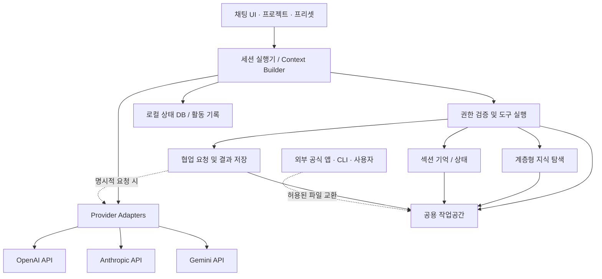

# AI Workspace — 최초 설계도

> 설계 기준 v0.1 · 2026-11-25 · Work 개발 인계용  
> 프로젝트명 `AI Workspace`는 가칭이다. 본 문서는 구현 결과가 아닌 최초 설계 및 개발 계획이다.

## 0. 개발 의도와 핵심 결정

이 프로젝트는 GPT, Claude, Gemini 및 향후 추가될 AI를 하나의 중앙 모델 아래에 종속시키는 범용 오케스트레이터가 아니다. 각 AI가 독립적인 작업 세션과 도구를 유지하면서, 공용 작업공간의 자료·진행 기억·방법론·산출물을 필요한 경우에만 참조하고 협업할 수 있게 하는 개인용 작업환경이다.

사용자 경험은 ChatGPT와 같은 자연어 중심 채팅을 지향한다. 내부에는 파일 작업, 계층형 탐색, 장기기억, 프리셋, 모델 연동과 협업 기능이 존재하지만 사용자가 매번 이를 설정하거나 호출 순서를 설계할 필요는 없다. 고급 설정과 작업 기록은 필요할 때 펼쳐 확인할 수 있어야 한다.

### 0.1 확정된 설계 원칙

| 원칙 | 구현상의 의미 |
|---|---|
| 독립 실행이 기본 | AI 세션은 독립적으로 진행된다. 모든 턴이 중앙 AI나 다른 모델을 경유하지 않는다. |
| 협업은 선택적 | 필요할 때만 자료·의견·산출물을 교환한다. 주작업 AI는 작업별로 달라질 수 있다. |
| 산출물과 규약을 공유 | 대화 전체보다 필요한 파일, 작업 상태, 원본 위치, 변경 이력, 검토 의견을 공유한다. |
| 기억의 역할을 분리 | 섹션 기억은 작업의 역사, 지식기억은 방법론과 참조 지식, 현재 상태는 당면한 과제를 표현한다. |
| 계층형 탐색 | 기본 안내도 → 영역별 개념 → 상세 정보 → 원본. 필요한 깊이까지만 탐색한다. |
| 분야별 프리셋 | 코딩·웹디자인·영상 제작 등 반복적으로 쓰는 분야별 환경을 제공한다. 일회성 요청은 자연어로 처리한다. |
| 직관적 사용 흐름 | 평소에는 프로젝트 선택, 채팅, 파일 첨부만으로 작업 가능해야 한다. |
| 결정론적 처리 우선 | 검색 인덱스, 파일 경로, 권한, 상태, 비용 계산은 프로그램이 관리한다. LLM은 해석과 판단에 사용한다. |
| 교체 가능성 | 모델 공급자, 저장 위치, 기억 처리 모델은 핵심 데이터 형식과 분리한다. |

### 0.2 이번 설계에서 제안하는 초기 구현 선택

- 로컬 우선(local-first), 단일 사용자, 웹 기반 로컬 UI로 시작한다. 데스크톱 패키징은 후순위다.
- 프로젝트별 공용 파일 저장소와 애플리케이션의 비공개 상태 저장소를 분리한다.
- 한 섹션에 여러 독립 세션을 둘 수 있지만, 섹션의 기억·현재 상태 변경은 버전과 작성자를 기록한다.
- 첫 버전의 프리셋은 주 작업 분야 하나와 독립적인 범용 토글 조합으로 시작한다. 웹디자인+코딩 등의 복수 분야 병합은 실제 사용 요구를 확인한 뒤 추가한다.
- 첫 버전은 API 연결이 가능한 모델을 대상으로 한다. 공식 앱의 내부 메모리, 세션, 구독 권한이 API로 공유된다고 가정하지 않는다.
- GitHub 저장소는 새로 만들 것을 제안하며, 이름·공개 여부·라이선스·기술 스택의 최종 확정은 Work에서 사용자와 확인한다.

## 1. 사용자 경험 및 범위

### 1.1 정상적인 작업 흐름

1. 프로젝트를 열고 기존 섹션을 선택하거나 새 섹션을 만든다.
2. 현재 작업 AI와 분야 프리셋을 선택한다. 선택값은 섹션별로 유지한다.
3. 자연어로 작업을 지시한다. 작업 AI는 섹션 기억과 기본 안내도를 필요에 따라 조회한다.
4. 관련 개념이나 자료의 경로를 탐색하고, 필요한 원본 범위만 읽는다. 사용자가 허용한 범위 안에서 파일을 작성·수정한다.
5. 필요하면 다른 AI에 독립적인 조사 또는 검토를 요청한다. 검토 결과는 공용 작업공간에 저장된다.
6. 주작업 AI는 관련 결과만 읽고 작업에 반영한다. 결과 통합 여부는 주작업 AI 또는 사용자가 결정한다.
7. 완료된 작업의 결과, 결정, 미해결 과제와 참조 원본을 기록한다. 필요한 경우 섹션 기억과 안내도 변경을 제안한다.

협업하지 않아도 1~4, 7의 경로로 정상적인 작업이 완료되어야 한다.

### 1.2 화면 구조

```text
┌──────────────────┬────────────────────────────────┬───────────────┐
│ 프로젝트 / 섹션   │ 현재 섹션 · AI 선택 · 프리셋     │ 작업공간 (접기) │
│                  │                                │               │
│ Project A        │          대화 및 산출물           │ 파일 / 기억     │
│   ├─ 설계         │                                │ 지식 / 협업     │
│   └─ 구현         │   [필요 시 작업 활동 펼치기]      │ 활동 / 변경     │
│                  │                                │               │
│ 새 섹션 / 설정     │ [첨부] [작업 입력] [도구] [전송]  │               │
└──────────────────┴────────────────────────────────┴───────────────┘
```

- 왼쪽: 프로젝트·섹션·대화 세션 관리. 기본 사용에서는 프로젝트/섹션만 알면 된다.
- 중앙: 스트리밍 채팅, 파일 참조, 작업 결과 및 코드·문서 미리보기. 모델 전환은 새로운 요청 또는 세션에 적용한다.
- 오른쪽: 기본적으로 접혀 있는 작업공간 패널. 파일 트리, 섹션 기억, 지식 안내도, 협업 요청·결과, 활동 기록을 탭으로 확인한다.
- 설정: 공급자/API 키, 작업공간 경로, 프리셋, 기억 설정, 비용 제한, 파일 권한. API 키의 전체 값은 화면이나 로그에 다시 출력하지 않는다.
- 작업 활동: 조회 문서, 파일 변경, 도구 실행, 협업 요청, 토큰/비용(확인 가능한 경우), 오류를 요약하고 상세 내역을 펼칠 수 있다.

UI 디자인은 초기에는 일반적인 채팅 앱 수준으로 제한한다. 노드 그래프 편집기, 복잡한 대시보드, 별도 문서 편집기 등은 필수 사항이 아니다.

### 1.3 초기 버전의 범위

| 범위 | 포함 기능 |
|---|---|
| MVP (v0.1) | 로컬 채팅, 프로젝트/섹션/세션, 최소 1개 API 공급자, 파일 탐색 및 승인형 쓰기, 기본 프리셋, 섹션 기억, 계층형 지식 탐색, 작업 기록 |
| 실용 버전 (v0.2) | 다중 공급자, 독립 세션, 모델 간 검토·조사 요청, 결과 저장/참조, 예산 및 권한, 오류 복구 |
| 확장 버전 (v0.3+) | 클라우드 저장소, 외부 공식 앱/CLI와 파일 기반 협업, 추가 검색 기술, 데스크톱 패키징 |

비목표: 범용 노코드 오케스트레이터, 무한 자율 에이전트, 다중 사용자 실시간 공동 편집, 공식 앱 전체 재현, 초기부터 모든 공급자의 모든 기능 지원, 완전한 지식 그래프 구축.

## 2. 시스템 아키텍처



여기서 세션 실행기는 중앙 지휘 AI가 아니다. 모델 선택, 입력 구성, 도구 검증, 응답 스트리밍, 기록을 수행하는 소프트웨어 구성요소다. 다른 AI의 결과를 매번 검토하거나 모든 세션의 맥락을 종합하지 않는다.

### 2.1 핵심 모듈

| 모듈 | 역할 | 하지 않는 일 |
|---|---|---|
| Session Runtime | 턴 실행, 스트리밍, 취소, 도구 호출 반복 제한 | 모든 프로젝트의 작업 지휘 |
| Context Builder | 활성 프리셋, 섹션 상태·기억, 최근 대화 및 참조 자료 조립 | 전체 작업공간 일괄 삽입 |
| Provider Adapters | 모델별 메시지·도구·사용량 변환, 기능 지원 여부 표시 | 공급자별 고유 기능을 강제로 동일화 |
| Workspace Service | 안전한 파일 탐색, 범위 읽기, 승인형 변경, 원본 연결 | 허가되지 않은 경로 접근 |
| Memory Service | 진행 이력 추출·요약·복원, 기억 버전 관리 | 사례를 일반 지식으로 자동 승격 |
| Knowledge Service | 안내도 탐색, 개념 연결, 원본 참조, 검색 인덱스 | 모든 지식을 매턴 프롬프트에 투입 |
| Preset Service | 분야별 지침 및 지식 진입점, 범용 기능 설정 | 사용자의 현재 작업 지시를 대신 결정 |
| Collaboration Service | 독립 작업 요청, 대상 모델 호출, 응답 저장 | 모든 작업에서 자동 다중 모델 호출 |
| Activity / Permissions | 권한·승인·실행 이력·오류·비용 제한 | 모델의 판단에 권한 검증 위임 |

### 2.2 최초 기술 스택 제안

| 계층 | 후보 | 선택 이유 |
|---|---|---|
| 언어 | TypeScript | UI, 런타임, API 연결의 타입과 계약 공유 |
| UI | React + Vite | 로컬 채팅 UI, 접이식 패널, 스트리밍 화면 구현 |
| 로컬 서버 | Node.js + Fastify (또는 동급의 경량 서버) | 서버 측 키 보관, 파일 도구, 공급자 호출 |
| 통신 | HTTP + SSE | 기본 요청과 응답 스트리밍, 초기 복잡성 제한 |
| 로컬 상태 | SQLite | 세션, 활동 로그, 요청 상태, 인덱스 등 트랜잭션 데이터 |
| 공유 데이터 | Markdown, JSON, JSONL 및 원본 파일 | 사람·AI·외부 도구가 공통으로 읽을 수 있고 Git으로 관리 가능 |
| 스키마 검증 | Zod 또는 동등한 스키마 도구 | 도구 입력과 파일 형식의 런타임 검증 |
| 테스트 | Vitest + Playwright (핵심 UI 흐름) | 결정론적 단위·통합 테스트와 실제 사용 경로 검증 |
| 패키지/CI | pnpm workspace + GitHub Actions | 단일 저장소, 공통 스크립트, PR마다 자동 검증 |

이는 확정된 의존성 목록이 아니다. Work 단계 0에서 현재 안정 버전, SDK 지원, 라이선스, Windows 호환성을 확인하여 선택하고 잠금 파일로 버전을 고정한다. MVP에서는 별도 벡터 DB, 컨테이너 오케스트레이션, 메시지 브로커가 필요하지 않다.

## 3. GitHub 저장소 구조

가칭: `AI-Workspace`. 소프트웨어의 소스 저장소와 실제 사용자의 프로젝트 데이터는 분리한다. `examples/`에는 합성 데이터만 포함한다.

```text
AI-Workspace/
├── README.md                    # 설치·실행·핵심 사용 흐름
├── AGENTS.md                    # 개발 AI 공통 작업 규약
├── package.json
├── pnpm-workspace.yaml
├── pnpm-lock.yaml
├── .gitignore
├── .env.example                 # 이름만, 실제 키 금지
├── .github/
│   ├── workflows/ci.yml
│   └── pull_request_template.md
├── docs/
│   ├── DESIGN.md                # 본 최초 설계도 및 후속 개정
│   ├── ARCHITECTURE.md           # 실제 구현 기준 구조와 데이터 흐름
│   ├── ROADMAP.md                # 단계별 목표·완료 기준
│   ├── DATA_CONTRACTS.md         # 공유 문서 스키마와 수명주기
│   ├── SECURITY.md               # 권한·승인·비밀 관리
│   └── adr/                     # 변경된 설계 결정과 이유
├── apps/
│   ├── web/                     # React UI
│   │   └── src/
│   │       ├── features/         # chat, projects, workspace, settings
│   │       ├── components/
│   │       └── app/
│   └── server/                  # 로컬 HTTP/SSE API 및 조립 지점
│       └── src/
│           ├── routes/
│           ├── bootstrap/
│           └── config/
├── packages/
│   ├── contracts/               # 공통 타입, 스키마, 이벤트·도구 규약
│   ├── core/                    # 세션 실행기, 컨텍스트, 승인, 협업, 프리셋
│   ├── providers/               # mock, openai, anthropic, gemini 등
│   ├── workspace/               # 파일 접근, 인덱스, 저장소 어댑터
│   └── memory/                  # 섹션 기억, 지식 탐색, 압축 로직
├── presets/                     # 기본 제공 프리셋과 짧은 지침
│   ├── general/
│   ├── coding/
│   ├── web-design/
│   ├── video-production/
│   └── research/
├── examples/
│   └── demo-workspace/          # 테스트·시연용 합성 작업공간
├── tests/
│   ├── integration/
│   ├── fixtures/
│   └── e2e/
└── scripts/                    # 개발 실행, 검증, 마이그레이션 등
```

실제 구현에서는 해당 기능이 개발되는 단계에 폴더를 생성한다. 빈 패키지와 사용되지 않는 추상화의 대량 생성은 금지한다. 작은 모듈은 `core` 하위에 두고 복잡성이 증가할 때 분리한다.

의존성 방향: `contracts` ← `core / providers / workspace / memory` ← `apps/server` ← HTTP 계약 ← `apps/web`. 각 기능 패키지의 직접 상호 의존은 가급적 피하고, 런타임에서 필요한 어댑터를 주입한다. UI는 API 키 또는 공급자 SDK를 직접 다루지 않는다.

## 4. 실제 공용 작업공간 구조

아래는 GitHub 소스 저장소와 별개로 사용자가 지정하는 데이터 폴더다. 파일명과 레이아웃은 v0.1 스키마의 제안이다.

```text
My-AI-Workspace/
├── INDEX.md                     # L0: 전체 지도 및 탐색 규약
├── workspace.json               # 스키마 버전, 프로젝트/지식 진입점
├── knowledge/                   # 범용 외부 지식기억
│   ├── INDEX.md
│   ├── coding/
│   │   ├── INDEX.md             # L1: 분야별 개념 지도
│   │   ├── concepts/           # L2: 방법론·규격·설명
│   │   └── sources/            # L3: 근거 자료 또는 원본 참조
│   ├── web-design/
│   └── video-production/
├── presets/                    # 사용자 정의·수정 프리셋
└── projects/
    └── example-project/
        ├── INDEX.md             # 프로젝트 목적·영역·핵심 경로
        ├── project.json         # 프로젝트 ID, 경로, 설정
        ├── knowledge/          # 프로젝트 특수 지식·설계 규약
        │   ├── INDEX.md
        │   └── concepts/
        ├── sections/
        │   └── feature-a/
        │       ├── section.json # ID, 제목, 활성 설정, 상태 참조
        │       ├── state.json   # 현재 목표·진행·담당·다음 행동
        │       └── memory/
        │           ├── INDEX.md # 요약 및 기간별 탐색 지도
        │           ├── summary.md
        │           └── events/ # 시간순 작업기록 (JSONL 또는 분할 파일)
        ├── decisions/           # 승인된 프로젝트 결정
        ├── collaboration/       # 요청·검토·응답 산출물
        └── artifacts/           # 실제 문서, 코드, 이미지 및 결과물
```

외부 코드 저장소를 프로젝트에 연결할 경우, `artifacts/`로 무조건 복사하지 않는다. 사용자가 승인한 외부 작업 루트를 `project.json`의 참조로 연결하고 파일 도구가 허가 범위 내에서 접근한다. 경로는 가능하면 루트 기준 상대 경로로 보관한다.

로컬 비공개 상태 디렉터리에는 SQLite, 앱 설정, 캐시, 원본 대화 기록 및 비공개 자격증명 참조를 둔다. 이 디렉터리는 공용 폴더와 분리하고 Git·클라우드 공유에 넣지 않는다. 사용자에게 내보내기를 제공하되 비공개 대화 전체를 자동 공유하지 않는다.

### 4.1 데이터의 권위와 동기화 규칙

- 공용 파일이 지식·기억·프로젝트 산출물의 원본이다. DB의 검색 인덱스는 재생성 가능하다.
- 원본 대화와 실행 상태는 로컬 DB가 권위 데이터다. 공용 기억 파일은 별도로 추출된 협업용 자료다.
- 협업 요청의 실행·취소 상태는 로컬 DB에서 관리한다. 공유 요청 및 응답 파일에는 요청 ID, 작성자, 버전과 결과를 기록한다. 재시작 시 동일 ID로 중복 호출하지 않도록 한다.
- 공유 문서는 단일 권위 경로를 갖는다. 요약이나 안내도는 원본을 복제해서 별도의 사실로 관리하지 않는다.
- 파일 변경 시 이전 버전 또는 해시를 확인한다. 예상 버전과 다르면 덮어쓰지 않고 충돌을 보고한다. 앱 내부는 쓰기 직렬화, 가능한 경우 임시 파일 후 원자적 교체를 사용한다.
- 초기에는 동시 작업을 단일 앱 인스턴스에서 조율한다. 외부 앱·클라우드와의 동시 쓰기 완전 보장은 후속 기능이다. 외부 편집은 재스캔 및 변경 충돌 감지로 대응한다.

## 5. 기억 및 지식 체계

### 5.1 역할 분리

| 종류 | 핵심 질문 | 저장 단위 | 갱신 기준 |
|---|---|---|---|
| 현재 상태 | 지금 무엇을 해야 하는가? | 섹션별 상태 스냅샷 | 작업 상태가 바뀔 때 |
| 섹션 장기기억 | 이 작업을 어떻게 진행해 왔는가? | 사건 기록, 구간 요약, 전체 요약 | 작업 진행 및 압축 조건 충족 시 |
| 외부 지식기억 | 이런 작업은 통상 어떻게 하면 좋은가? | 안내도, 개념, 원본 참조 | 검증된 지식·규격 변경 시 |
| 프로젝트 지식 | 이 프로젝트의 실제 설계와 계약은 무엇인가? | 개념, 확정 사양, 결정, 원본 | 프로젝트 변경 시 |
| 프리셋 | 이번 분야에서 어떤 기본 환경을 사용할 것인가? | 짧은 지침 및 진입점 | 사용자 설정 또는 버전 개정 시 |

섹션의 과거 시행착오를 범용 방법론으로 자동 승격하지 않는다. 반대로 범용 방법론이 실제 프로젝트에서 이미 내려진 결정인 것처럼 취급되지 않게 한다. 충돌하면 명확히 표시하고 확인한다.

### 5.2 섹션 장기기억 — 시간 기반

대화 원본에서 작업의 목표, 의미 있는 완료 사항, 실패한 시도, 결정과 이유, 미해결 과제, 산출물 참조를 추출한다. 잡담, 단순 반복, 기계적으로 재구성할 수 있는 정보는 요약에 과도하게 보존하지 않는다.

초기 제안: 완료된 사용자-모델 턴 5~10개 단위(기본값 8), 또는 설정된 컨텍스트 임계치에 도달했을 때 압축 후보를 생성한다. 명시적인 체크포인트에서도 생성할 수 있다. 초기 기본값은 실험을 위한 가설이며 실제 비용·복원 품질로 조정한다.

```text
원본 대화 (로컬 DB)
   → 작업 사건 추출 (ID와 출처 연결)
   → 구간 요약 (시간순)
   → 섹션 전체 요약 (필요할 때 압축)
   → 다음 세션에서 요약 + 현재 상태 + 필요한 구간 인출
```

기억 생성은 작업 턴과 분리된 명시적 실행 단위로 관리한다. 실패해도 원본은 남으며 재시도할 수 있어야 한다. 사건 기록은 수정 이력 또는 추가 정정 방식으로 보존하고, 요약을 갱신하면서 원본을 삭제하지 않는다. 같은 턴 범위를 반복 처리하지 않도록 체크포인트를 기록한다.

예시 스키마(설계용):

```json
{
  "schemaVersion": 1,
  "eventId": "evt-001",
  "sectionId": "feature-a",
  "sessionId": "session-a",
  "kind": "decision",
  "summary": "원본 데이터를 보존하고 변환 단계를 분리하기로 결정",
  "status": "confirmed",
  "author": "agent-a",
  "sourceRefs": [{"kind": "message_range", "from": "m-01", "to": "m-08"}],
  "artifactRefs": ["projects/example-project/decisions/001.md"],
  "createdAt": "2026-11-25T00:00:00Z"
}
```

현재 상태에는 목표, 진행 단계, 담당 세션, 미해결 과제, 다음 행동, 마지막 갱신 버전을 둔다. 기억에 담긴 모든 역사를 상태 파일에 반복해서 넣지 않는다.

### 5.3 외부 지식기억 — 개념 기반 계층 탐색

| 수준 | 내용 | 예시 |
|---|---|---|
| L0 | 전체 안내도 | 분야·프로젝트 목록, 탐색 규약, 경로 |
| L1 | 분야·영역별 개념 지도 | 모듈 역할, 주요 개념, 관계, 진입점 |
| L2 | 구체적인 지식·설계·절차 | 인터페이스 명세, 작업 방법, 근거와 예외 |
| L3 | 원본 | 실제 코드, 데이터, 자료, 문헌 및 출처 |

AI는 기본 안내도를 읽고 관련 개념을 찾아가며 필요한 부분까지 접근한다. 항상 L0~L3를 전부 읽어야 하는 것은 아니다. 정확한 원본 경로를 알고 있다면 직접 읽어도 된다. 폴더는 물리적 위치를 제공하고 개념 연결은 여러 영역 간 관계를 표현한다.

개념 문서의 최소 메타데이터는 `id`, 제목, 요약, 범위, 상태, 관련 개념, 원본 참조, 검증 시점/원본 버전이다. Markdown 본문과 구조화된 프런트매터 또는 JSON 사이드카 중 한 가지 규격을 선택한다.

```yaml
id: coding.metadata
summary: 이미지 생성 메타데이터를 추출하고 정규화하는 방법
scope: general
status: reviewed
related: [coding.file-io, coding.validation]
sources:
  - path: sources/metadata-format.md
    revision: null
last_verified_at: null
```

예시의 `null`은 검증되지 않았음을 뜻하며 검증 완료를 가장하지 않는다. 실제 문서에서 원본 해시·Git 커밋 또는 외부 출처 버전을 저장한다. 원본이 바뀌면 해당 지식의 검증 상태를 오래됨(stale)으로 표시하고 필요할 때 재검증한다.

초기 검색은 파일 트리, 개념 ID, 제목·키워드, SQLite FTS 등으로 구현한다. 임베딩 검색과 계층 요약 자동 구축은 검색 품질 평가 후 추가한다. 검색 결과는 원본 경로, 근거 범위, 요약 여부를 명시한다.

## 6. 프리셋, 범용 토글 및 컨텍스트 구성

### 6.1 분야별 프리셋

프리셋은 분야에 맞는 짧은 행동 지침과 지식 진입점, 선택적인 기본 도구를 제공한다. 코드 리뷰·최소 변경·전면 리팩터링 같은 일회성 요구를 토글로 만들지 않는다. 사용자가 채팅에서 직접 요청하면 된다.

| 프리셋 | 기본 안내 |
|---|---|
| 일반 | 별도 전문 지침 없음. 자연어 작업과 파일 참조 |
| 코딩 | 저장소 안내도, 구현 계약, 테스트·변경 기록 |
| 웹디자인 | 디자인 시스템, 반응형 구조, 접근성, 시각적 일관성 |
| 영상 제작 | 기획, 대본, 스토리보드, 에셋, 편집 흐름 |
| 조사·연구 | 출처, 근거, 가설, 불확실성, 연구 기록 |

```yaml
id: coding
version: 1
label: 코딩
instructions:
  - 프로젝트의 기본 안내도와 관련 구현 계약을 확인한다.
  - 필요한 범위의 원본과 테스트를 검토한다.
  - 실행하지 않은 검증은 통과한 것으로 보고하지 않는다.
knowledge_entries:
  - knowledge/coding/INDEX.md
```

### 6.2 범용 토글

| 토글 | 권장 기본값 | 의미 |
|---|---|---|
| 섹션 기억 참조 | ON | 저장된 진행 기억을 읽을 수 있음 |
| 외부 지식 참조 | ON | 분야·프로젝트 지식을 탐색할 수 있음 |
| 작업기억 갱신 | ON | 작업 사건과 요약을 생성할 수 있음 |
| AI 협업 허용 | OFF | 사용자가 요청하거나 명시적으로 승인한 다른 모델 호출 가능 |

토글은 능력의 허용 여부이며 항상 해당 기능을 실행한다는 의미가 아니다. 작업기억 참조 OFF는 기존 기억 삭제가 아니며, 갱신 OFF는 신규 요약·공유 기록 생성만 멈춘다. 일반 대화 기록과 보안·실행 감사 기록은 별도 정책이다. 권한 검증은 토글로 해제할 수 없다.

### 6.3 컨텍스트 조립

```text
시스템의 안전·권한 규약 (항상)
+ 활성 분야 프리셋 (짧게)
+ 섹션의 목표 및 현재 상태
+ 섹션 요약 / 최근 대화 (활성 여부와 예산에 따라)
+ 필요한 지식·파일·협업 결과 (검색 또는 도구로 선택적 인출)
+ 현재 사용자의 자연어 요청
```

컨텍스트 예산은 공급자 모델의 실제 한도와 출력 여유를 고려한다. 초과 시 오래된 대화 및 선택 자료를 우선 줄이고 현재 요청, 권한·핵심 사양은 보존한다. 원본 범위를 요청하면 모델의 도구 호출로 추가 인출한다. 전달된 자료의 경로·버전·출처를 기록하고 문서 내부 지시문은 신뢰할 수 있는 시스템 지침으로 승격하지 않는다.

## 7. 다중 AI 실행과 협업

### 7.1 독립 세션과 공급자 어댑터

각 세션은 공급자, 모델, 대화 기록, 적용 프리셋 및 현재 섹션 참조를 가진다. AI A가 작업하는 중에 AI B의 별도 세션을 열어 작업할 수 있다. B의 전체 대화가 A에 자동 삽입되지 않는다. 동일 섹션에 속하더라도 공유되는 것은 명시적으로 저장된 상태·기억·산출물이다.

공급자 어댑터는 공통 메시지와 도구 계약을 내부적으로 해당 공급자의 형식에 맞춘다. 모델별 특수 기능은 capability flags 및 선택 설정으로 유지한다. 미지원 기능은 UI에서 비활성화하거나 명시적으로 안내하고, 조용히 무시하지 않는다.

초기 어댑터 계약의 개념 예시:

```ts
interface ProviderAdapter {
  capabilities(model: string): ModelCapabilities;
  stream(request: ModelRequest, signal: AbortSignal): AsyncIterable<ModelEvent>;
}
```

실제 토큰 사용량·가격·지원 모델 목록은 공급자가 반환하거나 확인 가능한 정보만 사용한다. 모르는 값은 `unknown`으로 표시한다. 공통 모델 이벤트는 텍스트 델타, 도구 요청, 완료, 사용량, 오류 등을 포함한다. 공급자 응답의 원본 세부사항은 비밀값을 제거한 진단 정보로 별도 보존할 수 있다.

### 7.2 협업 방식

첫 단계에서는 사용자가 자연어로 요청한 협업만 실행한다. 예: “이 설계는 Claude에게 검토받아 보고 결과에서 필요한 부분만 참고해 줘.” 협업 토글이 꺼져 있거나 대상 호출이 비용·권한 정책을 벗어나면 요청을 실제로 실행하기 전에 사용자 확인을 받는다.

```text
주작업 AI A
  → 검토 목적·범위·참조 파일·기대 결과를 담은 요청 생성
  → 프로그램이 요청 검증 및 호출 승인 처리
  → AI B의 독립 세션에서 검토 실행
  → 검토 결과를 공유 폴더에 저장
  → A에 결과 경로와 상태 알림
  → A가 필요한 내용과 원본만 조회
  → 사용자 또는 A가 반영 여부 판단
```

협업 요청은 자기완결적인 작업 계약이어야 한다. 주작업 AI의 전체 컨텍스트를 전달하지 않고, 필요한 문제 설명·관련 파일·제약·결과 형식만 제공한다. 다른 세션의 민감 정보는 자동으로 가져오지 않는다.

```json
{
  "schemaVersion": 1,
  "id": "collab-001",
  "projectId": "example-project",
  "sectionId": "feature-a",
  "requesterSessionId": "session-a",
  "target": {"provider": "provider-b", "model": "configured-model"},
  "objective": "변경된 파서의 호환성 및 회귀 위험 검토",
  "references": [{"path": "artifacts/changes.diff", "revision": "example-revision"}],
  "expectedOutput": "주요 발견사항, 근거 위치, 수정 제안",
  "permissions": {"read": true, "writeArtifacts": false},
  "budget": {"maxOutputTokens": 3000, "maxFollowUps": 0}
}
```

상태: `pending → approved → running → completed / failed / cancelled`. 완료 결과에는 요청 ID, 작성자, 모델, 입력 참조, 발견사항·근거·불확실성, 결과 파일 경로, 종료 상태를 기록한다. 결과를 검증된 사실이나 확정된 프로젝트 결정으로 자동 승격하지 않는다.

MVP 이후에도 기본값은 단일 협업 요청 및 단일 응답이다. 자동 재검토, 연쇄 호출, 에이전트 간 자율 토론은 후속 옵션이다. 호출 횟수·예산·중단 조건 없이 실행되는 재귀 협업은 허용하지 않는다.

### 7.3 외부 공식 앱 및 CLI와의 연결

API 기반 세션과 공식 앱 기반 작업을 구별한다. 공식 앱이 허용된 도구, 커넥터, CLI 또는 파일 접근 기능을 제공한다면 공용 작업공간의 `INDEX.md`, 작업 계약, 결과 문서를 같은 형식으로 읽고 쓸 수 있게 한다. API로 공식 앱의 비공개 세션을 조작하거나 구독권으로 API 호출이 가능하다고 가정하지 않는다.

첫 연결 형태는 수동 파일 교환으로 충분하다. 이후 실제 접근 가능한 공식 도구를 조사하여 어댑터를 추가한다. 현재 설치된 도구와 계정 권한에 따라 지원되는 연결 범위가 달라질 수 있다. 비공식 화면 스크래핑이나 자격증명 우회는 목표가 아니다.

## 8. 파일 도구, 권한 및 운영 안정성

### 8.1 최소 도구 계약

| 도구 | 역할 | 기본 동작 |
|---|---|---|
| `list_entries` | 허용된 경로 목록과 파일 정보 조회 | 읽기 전용, 최대 반환 범위 제한 |
| `read_file` | 텍스트 파일의 필요한 범위 읽기 | 파일 크기·형식·범위 검사 |
| `search_workspace` | 개념 ID, 키워드, 문서 및 경로 검색 | 결과 수 제한, 출처와 경로 반환 |
| `get_section_state` | 현재 상태 및 기억 안내도 읽기 | 토글·프로젝트 권한 확인 |
| `propose_write` | 새 파일 또는 수정안 작성 | 경로·diff·이전 버전과 함께 승인 요청 |
| `record_memory` | 섹션 사건·요약 갱신 요청 | 스키마·버전 확인, 승인된 정책에 따라 기록 |
| `request_collaboration` | 다른 AI에 독립 작업 요청 | 권한·예산·명시적 승인 확인 |

도구 목록은 목표 계약이다. 각 개발 단계에서 필요한 도구만 구현한다. 파일 삭제, 셸 명령, 임의 프로그램 실행, 외부 업로드는 초기 자동 실행 대상이 아니다. 셸을 추가할 경우 별도의 격리·명령 제한·승인 설계를 거친다. 실행하지 않은 테스트를 성공이라고 기록하지 않는다.

### 8.2 보안 기준

- 서버는 기본적으로 loopback에 바인딩하고, 로컬 요청 인증 및 Origin 검증을 적용한다. 공개 네트워크에 무인증 API를 노출하지 않는다.
- API 키는 서버 측 환경 변수 또는 OS 보안 저장소를 사용하고, 브라우저·공용 작업공간·로그·Git에 평문으로 넣지 않는다.
- 파일 접근은 등록된 루트 아래로 제한한다. 경로 정규화, 실제 경로 확인, 심볼릭 링크 및 경로 탈출을 검증한다.
- 파일 쓰기 전 변경 미리보기 및 승인, 원본 버전 확인, 가능한 경우 복구용 백업을 제공한다. 대량 수정이나 삭제는 별도 높은 권한을 요구한다.
- 모델이 읽은 파일의 프롬프트 주입 문구는 데이터로 취급한다. 외부 문서나 협업 결과로 권한·예산·시스템 규칙을 변경할 수 없다.
- 외부 모델로 전송될 파일과 민감정보는 사용자 권한 및 명시된 공유 범위를 따른다. 미승인 파일 전송은 금지한다.
- 활동 로그에는 실행한 도구, 변경 경로, 승인 여부, 오류 및 확인 가능한 비용을 남기되 키·토큰 등 비밀값을 제거한다. 전체 입력 원문 보존은 선택 사항이다.
- 스트리밍 중단, 요청 취소, 타임아웃, 제한된 재시도를 제공한다. 쓰기와 유료 호출은 불명확한 실패에서 무조건 재시도하지 않는다.

### 8.3 로컬과 클라우드 저장소

| 구분 | 방향 |
|---|---|
| 로컬 PC | 첫 구현. 등록된 디렉터리의 읽기·쓰기, 외부 변경 감지 |
| Google Drive | 후속. 파일 및 문서 접근·공유를 위한 별도 저장소 어댑터 |
| Google Cloud Storage | 후속. 객체 저장소이며 로컬 파일시스템과 다른 버전·충돌 계약 필요 |
| Git | 코드 및 텍스트 산출물의 변경 이력·분기·검토. 앱의 모든 상태를 Git에 넣지 않음 |

Google Drive와 Google Cloud Storage를 같은 시스템으로 가정하지 않는다. 외부 저장소는 읽기 전용 연결부터 검증하고 쓰기, 버전 충돌, 인증, 동기화는 별도 단계에서 구현한다. SQLite 데이터베이스를 여러 환경에서 실시간 파일 동기화하지 않는다. 앱의 작업공간 인터페이스를 유지한 상태에서 필요한 저장소만 교체할 수 있어야 한다.

## 9. 개발 로드맵 및 단계별 완료 조건

일정은 기간이 아니라 완료 조건에 따라 진행한다. 각 단계는 실행 가능한 결과물을 남긴다. 다음 단계의 추상화와 UI를 미리 대량 구현하지 않는다.

| 단계 | 목표 | 핵심 작업 | 완료 조건 |
|---|---|---|---|
| P0 — 기반 | 개발 착수 가능한 저장소 | 저장소 초기화, 스택·버전 확정, 공통 스크립트, CI, 설계/작업 규약 | 깨끗한 환경에서 설치·빌드·테스트 통과. README로 재현 가능 |
| P1 — 기본 채팅 | 실제 사용 가능한 수직 기능 | UI, 로컬 서버, mock과 첫 API 공급자, 세션 저장, 스트리밍·취소, 프리셋 선택 | 첫 대화 및 재시작 복원. 키 노출 없음. mock으로 자동 테스트 가능 |
| P2 — 작업공간 | AI가 파일을 탐색하고 안전하게 작업 | 프로젝트·섹션, 폴더 연결, 안내도, 범위 읽기·검색, 승인형 파일 수정, 활동 기록 | 예제 프로젝트에서 탐색→원본 조회→승인→수정 재현. 경로 탈출 차단 |
| P3 — 두 종류의 기억 | 중단 후 작업 재개 및 지식 인출 | 섹션 사건·요약·상태, 계층형 개념 지도, 출처·stale 처리, 독립 토글, 컨텍스트 예산 | 새 세션이 목표·과거 결정·미해결 과제를 복원. 토글 OFF가 유효. 원본 변경 감지 |
| P4 — 다중 AI | 독립 실행 및 선택적 협업 | 추가 공급자, 세션 격리, 협업 요청·승인·실행·결과, 비용·권한 정책 | 두 공급자 또는 하나의 실제 공급자+mock에서 독립 세션 검증. 실제 두 공급자 연동 후 실용 버전 완료 |
| P5 — 외부 연동 | 공식 앱·CLI·클라우드와 공용 자료 교환 | 파일 교환 규약, Drive/GCS 중 사용 목적에 맞는 하나부터, 버전·충돌·오류 처리 | 외부에서 작성한 자료를 인식. 미승인 쓰기 방지. 충돌 발생 시 기존 파일 보존 |
| P6 — 완성도 | 일상 사용에 적합한 안정성 | 설치 편의, 오류 복구, UI 정돈, 데이터 내보내기·백업, 필요 시 데스크톱 패키징 | 새 사용자 환경에서 설치부터 작업·복원까지 문서만으로 재현. 회귀 테스트 통과 |

릴리스 기준: P0~P3 → v0.1 MVP, P4 → v0.2 실용 버전, P5 이후 → v0.3+. P2와 P3의 세부 PR 순서는 수직 기능에 맞춰 조정 가능하나 단계별 완료 조건을 생략하지 않는다.

### 9.1 첫 PR 단위 권장 계획

| PR | 작업 | 확인 항목 |
|---|---|---|
| #1 (예정) | 저장소 뼈대, 개발 스크립트, CI, 문서 | Windows 및 Linux 개발/CI 기초 확인 |
| #2 | mock 공급자, 공통 스트림 계약, 채팅 서버 | 응답 스트림·취소·오류 테스트 |
| #3 | 채팅 UI, 세션 저장·복원, 첫 API 공급자 | 실제 또는 명시적 mock 시연, 키 보안 |
| #4 | 프로젝트·섹션·프리셋 및 작업공간 등록 | 분리된 섹션과 설정 복원 |
| #5 | 안내도 및 파일 도구, 승인형 쓰기, 활동 로그 | 경로 검사, 쓰기 충돌, 변경 미리보기 |
| #6 | 계층형 지식 탐색 및 출처·버전 표시 | 정확한 원본 탐색, stale 감지 |
| #7 | 섹션 기억·현재 상태·컨텍스트 조립 | 압축·재개·토글·예산 테스트 |
| #8 이후 | 다중 공급자 및 협업 | 세션 격리, 승인, 비용, 응답 참조 |

PR 번호는 예시이며 실제 생성된 PR 번호가 아니다. 하나의 PR에 독립적으로 검토할 수 있는 기능과 테스트를 묶는다. 구현 난이도에 따라 추가 분할한다.

## 10. 개발 운영 방식 — Work, Codex 및 다른 AI

### 10.1 역할과 책임

| 참여자 | 기본 역할 |
|---|---|
| 사용자 | 제품 방향, 기능 우선순위, 주요 의사결정, 최종 승인 |
| Work | 최초 설계 검토, 저장소 작업 기반 마련, 요구사항 정리, 작은 구현/검증, PR 및 이슈 단위 계획 |
| Codex 또는 다른 코딩 에이전트 | 지정된 기능 구현·테스트·수정. 필요 시 별도 브랜치/워크트리 사용 |
| GPT·Claude·Gemini 등 검토 AI | 필요한 범위의 독립 설계 검토, 코드 리뷰, 자료 조사. 원본과 근거 중심 |

역할은 고정된 지휘계통이 아니다. 작업별 주담당 AI가 바뀔 수 있으며 검토가 필요 없는 작업에는 추가 AI를 투입하지 않는다. 여러 에이전트가 동시에 같은 기준 브랜치에서 파일을 수정하지 않는다.

### 10.2 GitHub 협업 규약

- `main`은 검증된 기준 브랜치로 사용한다. 기능별 브랜치 `feat/...`, 수정 `fix/...`, 문서 `docs/...`로 작업한다.
- 중요한 작업에는 GitHub Issue 또는 PR 본문에 목적, 범위, 완료 기준, 의존성, 관련 파일을 기록한다.
- 담당자가 구현하고 테스트한 후 PR에 실제 검증 결과와 제한사항을 기록한다. 검토자는 변경 diff와 관련 설계 계약부터 읽는다.
- 검토 의견은 PR 댓글 또는 검토 문서로 남긴다. 필요할 때만 추가 AI에게 의견을 구한다.
- 기준 브랜치 변경은 단일 통합 담당자와 사용자 승인 정책에 따른다. 사용 가능한 GitHub 보호 규칙을 설정할 수 있으면 적용한다.
- 설계 변경이 필요한 경우 ADR에 이유, 대안, 영향과 선택을 기록한다. 기존 설계 문서와 실제 구현의 불일치는 같은 PR에서 정리한다.
- 매 PR은 `lint`, `typecheck`, `test`, `build`를 기본 검증 대상으로 한다. UI나 데이터 계약 변경 시 해당 통합/E2E 테스트를 추가한다.
- 실제 API 키가 필요한 스모크 테스트는 옵트인으로 유지한다. CI에서는 mock과 고정 fixture로 재현 가능해야 한다. 유료 호출을 자동 CI에 강제하지 않는다.

### 10.3 AGENTS.md의 역할

초기 `AGENTS.md`에는 긴 설계 전체를 중복하지 말고 다음 항목만 넣는다.

1. 프로젝트 목적과 독립 실행 원칙.
2. 먼저 읽을 문서: `docs/DESIGN.md`, 현재 단계의 `ROADMAP.md`, 관련 데이터 계약.
3. 설치·개발·검증 명령과 수정 범위 규칙.
4. 파일·API 키·권한 관련 절대 준수사항.
5. PR 보고 형식: 변경 내용, 실제 테스트 결과, 제한사항, 설계 변경 여부.
6. 현재 단계에 없는 기능을 임의로 추가하지 않는 원칙.

Work나 코딩 에이전트가 기능을 구현할 때마다 전체 프로젝트 문서를 다시 작성할 필요는 없다. 필요한 문서와 원본을 찾고 바뀐 부분만 갱신한다. 이 개발 방식 자체가 본 프로젝트의 공용 작업공간 철학을 시험하는 첫 사례가 된다.

## 11. 검증 전략과 성공 지표

기능 수보다 실제 작업에 쓰기 편한지 검증한다. 첫 예제 작업은 코드 프로젝트를 대상으로 하되, 웹디자인 또는 영상 제작 예제도 추가하여 코딩 전용 구조가 되지 않았는지 확인한다.

| 검증 시나리오 | 합격 기준 |
|---|---|
| 단일 AI의 기본 작업 | 다른 모델 호출 없이 채팅→자료 탐색→산출물 생성 가능 |
| 작업 중단 후 재개 | 새로운 세션이 전체 과거 대화 없이 목표·확정 결정·미해결 과제를 복원 |
| 계층 탐색 | 안내도에서 필요한 원본을 찾으며 불필요한 전체 파일 삽입을 피함 |
| 프리셋 전환 | 작업 분야를 바꿔도 기존 섹션 기억과 산출물 보존 |
| 토글 독립성 | 기억 참조 OFF, 지식 OFF, 갱신 OFF 등의 효과가 다른 기능을 예기치 않게 바꾸지 않음 |
| 독립 협업 | 검토 AI에 필요한 정보만 전달. 검토 결과 경로 확인 후 주작업 AI가 선택적으로 반영 |
| 안전성 | 경로 탈출, 미승인 쓰기, 미승인 외부 호출, 비밀값 노출을 차단 |
| 장애 복구 | API 오류·스트림 취소·재시작·파일 충돌 후 원본 및 작업 상태 보존 |
| UX | 설정 완료 뒤 일반 작업에서 프리셋·모델 재선택이나 수동 노드 설정을 매번 요구하지 않음 |

성능 및 품질 비교는 다음과 같이 기록한다. 수치 목표는 실제 기준선 측정 이후 확정한다.

- 컨텍스트: 전체 자료 삽입 방식 대비 입력 토큰 및 읽은 파일 수.
- 기억: 동일한 과거 사건 세트의 핵심 결정·미해결 과제 복원 정확도와 근거 추적 가능성.
- 검색: 관련 원본의 상위 검색 포함 여부, 불필요한 파일 조회 수, 오래된 안내도의 탐지율.
- 협업: 단일 모델 대비 발견한 유효 결함, 불필요한 재검토 횟수, 추가 비용과 소요 시간.
- 사용성: 기본 작업 완료에 필요한 사용자 입력 및 조작 수, 오류 이후 복구 가능 여부.

정답이 있는 고정 fixture로 계약·검색·권한을 테스트한다. LLM 평가에서는 결과의 확률적 변동을 고려하며, 작은 반복 실험 결과를 전체 작업에 대한 성능 보장으로 해석하지 않는다.

## 12. 주요 위험과 대응

| 위험 | 대응 |
|---|---|
| 초기에 설계가 비대해짐 | 기능 수직 구현, 단계별 비목표 유지, 사용하지 않는 패키지·추상화 보류 |
| 모델별 API 차이 | 공통 계약 최소화, 기능 지원 플래그, 공급자별 어댑터 테스트 |
| 기억의 요약 오류 | 원본 참조, 정정 이력, 확정/추정 구분, 중요한 결정의 원본 재검증 |
| 지식 안내도의 노후화 | 버전·해시 기반 stale 표시, 검증된 변경만 반영 |
| 공유 파일 충돌 | 버전 확인, 직렬 쓰기, 충돌 보고, 외부 동시 편집 보장 범위 명시 |
| 협업 비용 폭증 | 호출 예산·횟수·시간 제한, 중단·승인, 재귀 기본 금지 |
| 복잡한 UI | 기본 채팅 중심, 고급 패널 접기, 범용 토글 독립 유지 |
| 공식 앱과의 연동 제한 | 파일 교환 우선, 지원되는 공식 접근 경로만 추가 |
| 클라우드 데이터 노출 | 로컬 우선, 최소 전송 범위, 저장소별 권한, 비밀·원본 대화 분리 |

## 13. Work 착수 전 확인할 사항

아래는 최초 설계에서 확정하지 않은 구현 결정이다. Work는 접근 가능한 환경과 실제 요구사항을 검토해 결정하고, 중요한 변경은 사용자에게 설명한다.

| 확인 사항 | 최초 제안 |
|---|---|
| 저장소 이름 및 공개 여부 | `AI-Workspace` 가칭, 공개 여부 미결정 |
| 라이선스 | 미결정. 공개 계획 및 의존성 검토 후 결정 |
| 첫 API 공급자 | 현재 보유한 API 키와 개발 편의성을 기준으로 선택, mock은 필수 |
| 기술 스택의 정확한 버전 | P0에서 공식 문서·호환성 확인 후 고정 |
| 첫 배포 형태 | 로컬 웹앱, 이후 필요하면 데스크톱 패키징 |
| 지식 초기 데이터 | 일반·코딩 프리셋과 합성 예제부터 시작. 실제 개인 파일은 자동 반입하지 않음 |
| 저장소 연결 | 로컬 우선. Drive/GCS/공식 앱 연결은 후속으로 실제 권한 확인 |
| 클라우드 개발 환경 | Work가 실제 접근 가능한 개발 환경에서 작업하고, 로컬 PC 실행 확인은 필요한 경우 별도 검증 |

이 문서는 실제 API 연동, 공급자 기능, GitHub 권한, 설치환경 검증을 수행한 결과가 아니다. 구현 전 확인 사항으로 유지한다.

---

## 부록 A. Work 인계용 최초 지시

아래 내용을 본 문서와 함께 Work에 전달한다.

> 첨부된 `AI_Workspace_Initial_Design_v0.1.md`를 최초 설계 기준으로 사용해 줘. 이 프로젝트는 중앙 AI가 모든 작업을 지휘하는 오케스트레이터가 아니라, 각 AI가 독립적으로 작업하며 필요할 때만 공용 작업공간을 통해 협업하는 개인용 AI 작업환경이다.
>
> 먼저 설계의 일관성, MVP 범위, 기술 스택의 실제 호환성, GitHub 저장소 구조를 검토하고 P0를 준비해 줘. 저장소명·공개 여부·라이선스 등 중요한 미결정 사항은 임의로 확정하지 말고 명시해 줘. 저장소 생성/변경은 사용자 권한과 승인 범위 내에서 진행해 줘.
>
> 구현을 착수할 경우 본 문서를 `docs/DESIGN.md`로 보존하고 `README.md`, `AGENTS.md`, `docs/ROADMAP.md`와 개발·CI 기반을 마련해 줘. 처음부터 모든 패키지나 기능을 생성하지 말고, 실제 실행 가능한 최소 기반 및 mock 기반 검증 경로를 우선해 줘.
>
> P0 완료 후 P1의 독립적인 채팅·세션·첫 공급자 수직 기능을 PR 단위로 진행할 수 있게 작업 범위, 완료 기준, 필요한 후속 이슈를 정리해 줘. 이번 단계에서 멀티 AI 오케스트레이션, 임베딩 DB, 클라우드 동기화, 데스크톱 패키징을 미리 구현할 필요는 없어.
>
> 보고 시 실제 수행한 작업, 변경 파일, 테스트 실행 결과, 미검증 사항, 설계에서 달라진 결정과 이유를 구분해 줘. 구현되지 않은 기능을 완성됐다고 보고하지 말고, 사용자가 자연어로 작업하는 단순한 흐름을 지속적으로 최우선에 둬.

## 부록 B. 최종 설계 철학 한 문장

**사용자는 AI와 대화하는 데 집중하고, 프로그램은 그 대화가 실제 작업으로 이어지도록 기억·자료·도구·협업을 관리한다. 각 AI의 독립성은 유지하며 복잡성은 필요한 순간에만 드러낸다.**
